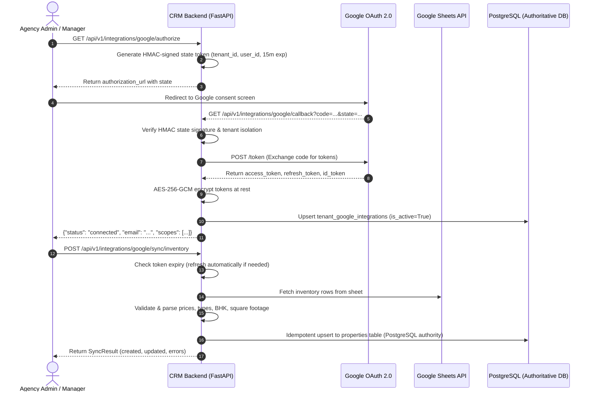

# Google OAuth 2.0 & Google Sheets Integration Guide

This guide documents the architecture, configuration, security model, and operational synchronization for the Google OAuth 2.0 and Google Sheets integration in the AI Real Estate CRM.

---

## 1. Architecture Overview

The Google integration enables agency tenants to connect their Google accounts securely via OAuth 2.0 to synchronize property inventory and lead qualification data with Google Sheets.



---

## 2. Exact OAuth Callback URL

The standard callback URL registered with FastAPI routing is:

```text
/api/v1/integrations/google/callback
```

### Full URI in Development:
```text
http://localhost:8000/api/v1/integrations/google/callback
```

### Full URI in Staging / Production:
```text
https://<YOUR_API_DOMAIN>/api/v1/integrations/google/callback
```

> [!IMPORTANT]
> The exact redirect URI used in API calls must match the URI configured in the Google Cloud Console character-for-character, including scheme, port, and trailing slashes.

---

## 3. Google Cloud Console Setup

1. **Create or Select a Project**:
   - Navigate to [Google Cloud Console](https://console.cloud.google.com/).
   - Create a project (e.g. `HAVN Realty CRM`) or select an existing one.

2. **Enable Required APIs**:
   - Go to **APIs & Services** $\to$ **Library**.
   - Search for and enable:
     - **Google Sheets API**
     - **Google Drive API** (optional, recommended if searching files)
     - **Identity Toolkit API** / **Google People API**

3. **Configure OAuth Consent Screen**:
   - Go to **APIs & Services** $\to$ **OAuth consent screen**.
   - User Type: Select **Internal** (if using Google Workspace) or **External** (for general agency users).
   - App Name: `AI Real Estate CRM`.
   - User support email: Enter your administrator email.
   - Developer contact email: Enter your engineering contact email.
   - Scopes: Add `.../auth/spreadsheets`, `openid`, and `.../auth/userinfo.email`.

4. **Create OAuth 2.0 Credentials**:
   - Go to **APIs & Services** $\to$ **Credentials** $\to$ **Create Credentials** $\to$ **OAuth client ID**.
   - Application type: **Web application**.
   - Name: `AI Real Estate CRM Backend`.
   - **Authorized JavaScript origins**:
     - `http://localhost:8000`
     - `http://localhost:5173`
   - **Authorized redirect URIs**:
     - `http://localhost:8000/api/v1/integrations/google/callback`
   - Click **Create**. Note your `Client ID` and `Client Secret`.

---

## 4. Minimum Required Scopes

To follow the principle of least privilege, request only the minimum scopes necessary:

| Scope | Purpose |
| :--- | :--- |
| `https://www.googleapis.com/auth/spreadsheets` | Read and write property inventory and qualification sheets |
| `openid` | OpenID Connect identity assertion |
| `https://www.googleapis.com/auth/userinfo.email` | Display connected agency Google account email in CRM status |

---

## 5. Environment Variables Configuration

Add the following to your `.env` file (see [`.env.example`](file:///c:/Users/vashi/OneDrive/Desktop/AI%20Real%20Estate%20CRM/.env.example)):

```bash
# Google OAuth 2.0 Client Credentials
GOOGLE_CLIENT_ID="your-client-id.apps.googleusercontent.com"
GOOGLE_CLIENT_SECRET="your-client-secret"
GOOGLE_REDIRECT_URI="http://localhost:8000/api/v1/integrations/google/callback"

# Optional dedicated HMAC secret for signing OAuth state tokens (defaults to APP_ENCRYPTION_KEY if empty)
GOOGLE_OAUTH_STATE_SECRET=""

# Operational sync mode: mock (offline tests & local dev) | real (live Google API)
GOOGLE_SHEETS_MODE="mock"

# Default fallback spreadsheet ID (per-tenant spreadsheet IDs can also be set via API)
GOOGLE_SHEETS_SPREADSHEET_ID="your-google-spreadsheet-id"
```

> [!CAUTION]
> Never commit `.env` or credential JSON files to Git. Both are strictly excluded in `.gitignore`.

---

## 6. Secure Credential Handling

1. **Encryption at Rest**:
   - Stored Google OAuth `refresh_token` and `access_token` values are encrypted using AES-256-GCM via `encrypt_field()` in [`backend/app/core/security.py`](file:///c:/Users/vashi/OneDrive/Desktop/AI%20Real%20Estate%20CRM/backend/app/core/security.py).
   - Nonce and ciphertext are combined and Base64-encoded.
2. **Zero Credential Leakage**:
   - The status endpoint (`GET /api/v1/integrations/google/status`) returns `is_connected`, connected email, granted scopes, and sync statistics, but **never returns tokens or encryption keys**.
3. **Cryptographic OAuth State**:
   - OAuth state parameters are signed using HMAC-SHA256 with timestamped expiration (15 minutes max TTL) and explicit `tenant_id` binding.
   - Prevents CSRF attacks, replay attacks, and cross-tenant credential injection.
4. **Revoked Token Detection**:
   - If a tenant disconnects or revokes permissions from their Google Account settings, Google returns an `invalid_grant` error on token refresh.
   - The service catches this, marks `is_active=False`, timestamps `revoked_at`, and surfaces a clear status message prompting re-connection.

---

## 7. PostgreSQL Database Authority & Sync Policy

PostgreSQL remains the CRM's authoritative system of record.
- **Dynamic Open-Ended Range (`A1:Z`)**: Range fetching dynamically reads `f"{sheet_name}!A1:Z"`, seamlessly supporting inventory spreadsheets beyond 500 rows while preserving the configured worksheet name.
- **Deterministic Identity & Row Movement**: Property identity is determined by explicit external ID or a deterministic hash of `(tenant_id, owner_phone, location_norm, property_type)`. Row index, prices, remarks, and dates are excluded from the hash, guaranteeing that reordering rows, moving rows, or negotiating prices/remarks updates existing properties in place without generating redundant records.
- **Inventory Staging Workflow**: Rows with missing prices, ambiguous property types, or candidate duplicate matches are safely placed in `inventory_staging_items` for agency manager review without blocking valid listings.
- **Repeat-Sync Idempotency**: Repeated sync passes are strictly idempotent: unchanged listings update in place (`created=0, updated=N`), and unchanged invalid rows or duplicate candidates update existing staging records in place (`mock_db.add.call_count == 0`), producing 0 duplicate properties and 0 duplicate staging records.
- **Private Contact Separation**: Owner names and phone numbers are stored privately in dedicated CRM fields and never exposed in public descriptions, API responses, or logs.


---

## 8. Local Testing Instructions

### Running the Automated Unit Test Suite (Offline / Mock Mode)
No Google Cloud credentials or network connection are required to run tests. Tests utilize `MockGoogleSheetsClient` and mock OAuth HTTP exchanges:

```powershell
.venv\Scripts\python -m pytest backend/tests/unit/test_google_oauth_and_sheets.py -v
```

### Testing with a Real Google Account Locally
1. Configure real credentials in `.env`:
   ```bash
   GOOGLE_CLIENT_ID="<your-real-client-id>"
   GOOGLE_CLIENT_SECRET="<your-real-client-secret>"
   GOOGLE_REDIRECT_URI="http://localhost:8000/api/v1/integrations/google/callback"
   GOOGLE_SHEETS_MODE="real"
   ```
2. Start the FastAPI development server:
   ```powershell
   .venv\Scripts\python -m uvicorn app.main:app --host 0.0.0.0 --port 8000 --reload
   ```
3. Log in as an Agency Admin to get a JWT access token.
4. Call `GET http://localhost:8000/api/v1/integrations/google/authorize` with `Authorization: Bearer <TOKEN>`.
5. Open the returned `authorization_url` in your browser and authorize the application with your Google account.
6. Check `GET http://localhost:8000/api/v1/integrations/google/status` to confirm status is `connected`.
